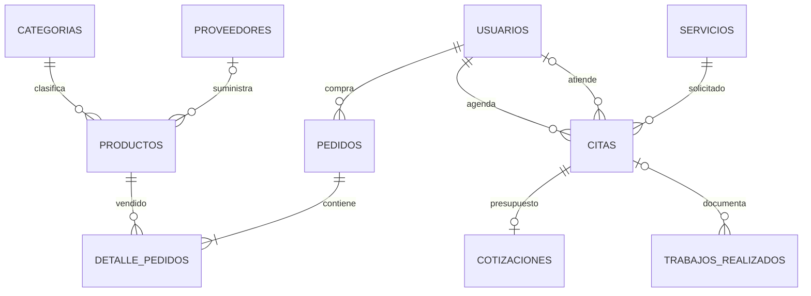

# AlphaBike Backend

API REST de AlphaBike construida con Java 21, Spring Boot, Spring Security, JWT, JPA, PostgreSQL, MongoDB y Flyway.

## Despliegue en Render

Incluye `render.yaml` para preparar el backend Docker en Render y conectarlo a PostgreSQL/MongoDB externos. Seguir la [guia de despliegue](docs/despliegue-render.md), incluida la limitacion de SMTP del plan gratuito y el cambio de URL del frontend. El archivo no acredita un servicio ya desplegado.

## PostgreSQL + MongoDB

Se utilizan ambos motores: PostgreSQL para usuarios, catalogo, citas, ventas y pagos; MongoDB para el historial persistente de estados de citas, visible para cliente, encargado y administrador. Una outbox transaccional SQL permite reintentar la escritura documental sin perder eventos por una interrupcion de MongoDB.

Ver [modelo, configuracion, permisos y comprobacion SQL + NoSQL](docs/persistencia-sql-nosql.md). `docker compose up --build -d` levanta ambos motores con volumen persistente. La migracion **V27** crea la cola y las instantaneas iniciales de citas existentes.

Ver [estado comprobado del entorno publicado y pasos de recuperacion](docs/verificacion-entorno-publicado.md). La URL Railway usada por el frontend respondio `Application not found` en la comprobacion del 10/11/2026; las pruebas locales y CI no acreditan ese despliegue.

## Seguridad urgente

Las credenciales de Supabase y el JWT secret estuvieron publicadas en `application.properties`. Deben rotarse antes de volver a usar el entorno:

- Cambiar la password del usuario de Supabase/PostgreSQL.
- Generar un `JWT_SECRET` nuevo, aleatorio y de al menos 32 caracteres.
- Invalidar tokens emitidos con el secreto anterior.
- Revisar el historial Git si el repositorio fue publico.

## Variables requeridas

Copia `backend/.env.example` a `backend/.env` y configura tu PostgreSQL. También puedes exportar variables del sistema; hay un ejemplo ampliado en `backend/src/main/resources/application-example.properties`.

| Variable | Descripcion |
| --- | --- |
| `DB_URL` | JDBC URL de PostgreSQL. |
| `DB_USERNAME` | Usuario de base de datos. |
| `DB_PASSWORD` | Password de base de datos. |
| `MONGODB_URI` | URI MongoDB de la base `alphabike`, con credenciales y `authSource` cuando corresponda. |
| `HISTORIAL_ENABLED` | Activa el historial MongoDB. Default `true`; debe estar activo para la entrega SQL + NoSQL. |
| `JWT_SECRET` | Secreto JWT de al menos 32 caracteres. |
| `JWT_EXPIRATION_MS` | Expiracion del token en milisegundos. Default: `86400000`. |
| `SERVER_PORT` | Puerto del backend. Default: `8080`. |
| `WS_ALLOWED_ORIGINS` | Origenes permitidos para `/ws/citas`; hereda `CORS_ALLOWED_ORIGINS` si se omite. |
| `CORS_ALLOWED_ORIGINS` | Origenes permitidos separados por coma. Default: `http://localhost:5173,http://127.0.0.1:5173,http://localhost:5174,http://127.0.0.1:5174`. |
| `JPA_DDL_AUTO` | Modo Hibernate. Default: `validate`. |
| `FLYWAY_ENABLED` | Habilita migraciones. Default: `true`. |
| `APP_SEED_ADMIN_ENABLED` | Crea/restaura un admin de desarrollo. Default: `false`. |
| `APP_SEED_ADMIN_EMAIL` | Email del admin seed. Default: `admin@alphabike.com`. |
| `APP_SEED_ADMIN_PASSWORD` | Password del admin seed. Obligatoria si el seed esta activo. |
| `APP_SEED_ADMIN_NAME` | Nombre del admin seed. |
| `APP_SEED_ADMIN_PHONE` | Telefono del admin seed. |
| `SPRINGDOC_API_DOCS_ENABLED` | Habilita `/v3/api-docs`. Default: `false`. |
| `SPRINGDOC_SWAGGER_UI_ENABLED` | Habilita Swagger UI. Default: `false`. |
| `APP_FRONTEND_URL` | URL del frontend para verificacion y recuperacion. |
| `MAIL_HOST`, `MAIL_PORT` | Servidor y puerto SMTP. |
| `MAIL_USERNAME`, `MAIL_PASSWORD` | Credenciales SMTP; no deben subirse a Git. |
| `APP_MAIL_FROM` | Remitente de los correos de AlphaBike. |
| `APP_MAIL_LOG_LINKS` | Permite imprimir enlaces con token solo en desarrollo. Default: `false`. |

## Admin local de desarrollo

La migracion inicial crea tablas, pero no crea usuarios. Para recuperar un admin local de prueba, agrega estas variables en `backend/.env` y reinicia el backend:

```properties
APP_SEED_ADMIN_ENABLED=true
APP_SEED_ADMIN_EMAIL=admin@alphabike.com
APP_SEED_ADMIN_PASSWORD=admin1234
APP_SEED_ADMIN_NAME=Administrador AlphaBike
APP_SEED_ADMIN_PHONE=999999999
```

Ese seed solo debe usarse en desarrollo. En produccion o Supabase real, crea/restaura el usuario admin con una contrasena nueva y privada.

## Ejecutar local

```bash
cd backend
mvn spring-boot:run
```

## Ejecutar sin Supabase

Si no tienes las credenciales de Supabase, usa el perfil `demo`. Este perfil levanta una base H2 local en `backend/data`, crea datos de prueba y restaura este admin:

```txt
admin@alphabike.com
admin1234
```

Comando:

```bash
cd backend
mvn spring-boot:run "-Dspring-boot.run.profiles=demo"
```

Este modo es solo para desarrollo o presentacion local. No reemplaza PostgreSQL/Supabase para produccion.

Swagger queda disponible en el perfil `demo` o habilitando `SPRINGDOC_API_DOCS_ENABLED=true` y `SPRINGDOC_SWAGGER_UI_ENABLED=true`:

- `http://localhost:8080/swagger-ui.html`
- `http://localhost:8080/v3/api-docs`

## Tests

```bash
cd backend
mvn test
```

Los tests usan perfil `test`, H2 en memoria y Flyway deshabilitado.

## Integridad de compras y pagos

- El registro y el inicio de sesion no entregan un JWT hasta verificar el correo. Una cuenta sin verificar recibe un error y puede solicitar el reenvio desde Login. Los usuarios creados por un administrador y los usuarios seed de desarrollo se crean verificados. Configura SMTP antes de probar el registro publico; para una demostracion sin SMTP, crea los usuarios desde el panel administrativo.
- Los pedidos pendientes pueden cancelarse con `PATCH /api/v1/pedidos/{id}/cancelar`; la operacion devuelve el stock reservado.
- El backend valida propiedad, estado, monto exacto y pago duplicado antes de registrar un pago.
- La migracion `V25` impide dos pagos aprobados para una misma referencia incluso ante solicitudes concurrentes.
- El frontend usa un proveedor `SANDBOX` para la demostracion academica. Para cobrar dinero real debe integrarse un proveedor externo y conservarse la validacion del lado servidor.

## Docker

Con `alphabike-backend` y `alphabike-frontend` clonados como carpetas hermanas, ejecuta desde `alphabike-backend`:

```bash
docker compose up --build
```

Servicios:

- Frontend: `http://localhost:5173`
- Backend: `http://localhost:8080`
- PostgreSQL: `localhost:5432`

## Migraciones

Las migraciones viven en `backend/src/main/resources/db/migration`. La migracion inicial crea los esquemas base sin borrar datos. Los resets destructivos deben hacerse manualmente solo en entornos locales.


## Avance 2 Semana 14

Implementa CRUD conectado a PostgreSQL, validación, errores centralizados y notificaciones bidireccionales por WebSocket nativo de Spring. El cliente recibe cambios de sus citas; el personal autorizado recibe cambios del taller. Las notificaciones se publican después del commit y la interfaz recupera el estado persistido por REST.

- [Modelo de datos completo y esquemas](docs/diagrama-er.md).
- [Protocolo, variables, arquitectura y guion de exposición](docs/avance-2.md).
- `ws://localhost:8080/ws/citas` en desarrollo, `wss://` con HTTPS.
- Primer frame: `{"type":"AUTH","token":"JWT"}`. Respuesta `READY`; `SYNC` → `CITAS_SYNC`; `PING` → `PONG`.
- Evento de cambio: `CITA_UPDATED`, con `citaId` y `estado`. Sin tokens en URLs ni eventos de otros clientes.
- Mantener backend y frontend en procesos separados o usar Docker Compose.

### Diagrama entidad relación



Los pagos apuntan a pedido o cotización por tipo e ID; se validan en servicio y tienen unicidad de pago confirmado en PostgreSQL.

### Pruebas de integración PostgreSQL

La suite rápida usa H2. El [workflow de CI](.github/workflows/ci.yml) ejecuta además `Avance2IntegrationTest` con PostgreSQL 16, migraciones reales y `ddl-auto=validate` en cada pull request hacia main/master y cada push a esas ramas. Para repetir la prueba localmente en una base **exclusiva de pruebas** configura:

```properties
TEST_DB_URL=jdbc:postgresql://localhost:5432/alphabike_test
TEST_DB_USERNAME=alphabike
TEST_DB_PASSWORD=your-local-test-password
TEST_DB_DRIVER=org.postgresql.Driver
TEST_DB_DIALECT=org.hibernate.dialect.PostgreSQLDialect
TEST_SQL_INIT_MODE=never
TEST_DDL_AUTO=validate
TEST_FLYWAY_ENABLED=true
```

Exporta esas variables en tu shell y ejecuta desde `backend`:

```bash
mvn -B -Dtest=Avance2IntegrationTest test
```

La suite crea datos de prueba. Nunca apuntar TEST_DB_URL a producción. Las pruebas cubren CRUD HTTP, cotizaciones aceptadas, cancelación idempotente, permisos y conexiones WebSocket reales con aislamiento entre usuarios.

### Validacion de entrada

Los textos persistidos se limitan a la longitud de sus columnas y los importes de entrada a NUMERIC(10,2). Parametros ausentes o de tipo incorrecto responden 400; metodos no admitidos, 405; tipos de contenido no admitidos, 415. Las violaciones de integridad persistente siguen respondiendo 409 sin exponer SQL.

Los pedidos de delivery/envio requieren direccion; el recojo en tienda no. No se permiten detalles nulos. Los precios acordados por parametro HTTP se validan tambien en el servicio, junto con subtotales y total calculados, para evitar redondeos silenciosos o desbordamientos de NUMERIC(10,2).

### Venta presencial y reportes

`POST /api/v1/pedidos/venta-presencial` es exclusivo de ADMIN/ENCARGADO y recibe `operacionId` UUID, `metodoPago` y `detalles`. El servidor crea el pedido de recojo y registra el pago con su total exacto dentro de una sola transaccion. Un rechazo revierte pedido y stock. Repetir el mismo UUID y contenido devuelve el mismo pedido; cambiar el contenido con ese UUID se rechaza. V26 agrega las columnas y el indice unico sin borrar datos existentes; Flyway debe permanecer habilitado al actualizar.

Los ingresos se obtienen de pagos confirmados. Descuentos, ventas por encargado y unidades vendidas incluyen solo pedidos con pago confirmado y excluyen cancelados. Los contadores totalPedidos/totalCitas representan registros de todos los estados; servicios populares representa citas no canceladas, no ventas pagadas.
