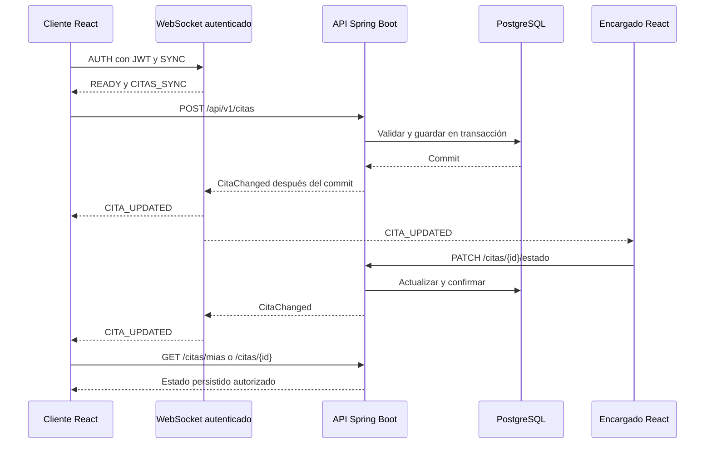

# Avance 2 Backend persistencia y tiempo real

## Arquitectura y flujo de datos



El WebSocket notifica cambios; REST entrega el estado completo autorizado. No hay polling ni necesidad de recargar la página. El evento se emite después del commit: una operación fallida no anuncia un cambio inexistente.

## Protocolo WebSocket

Endpoint nativo de Spring: `ws://localhost:8080/ws/citas`. Con HTTPS usar `wss://`. No requiere Socket.io, SockJS ni STOMP; ambos lados usan el protocolo WebSocket estándar.

El handshake está abierto para permitir la conexión del navegador, pero no se entrega ningún dato hasta autenticar el primer mensaje. El JWT viaja en el frame y nunca en la URL. Una conexión sin autenticar se cierra tras el plazo de autenticación; token inválido, expirado, cuenta inactiva o no verificada provocan cierre 1008. Los orígenes permitidos se configuran expresamente.

| Dirección | Mensaje JSON | Efecto |
|---|---|---|
| Cliente → servidor | `{"type":"AUTH","token":"JWT"}` | Autentica la conexión |
| Servidor → cliente | `{"type":"READY"}` | Autenticación correcta |
| Cliente → servidor | `{"type":"SYNC"}` | Solicita reconciliar la interfaz |
| Servidor → cliente | `{"type":"CITAS_SYNC"}` | La interfaz vuelve a consultar su snapshot REST |
| Cliente → servidor | `{"type":"PING"}` | Comprueba actividad |
| Servidor → cliente | `{"type":"PONG"}` | Confirma canal bidireccional |
| Servidor → cliente | `{"type":"CITA_UPDATED","citaId":"UUID","estado":"EN_PROCESO"}` | Notifica creación, estado, asignación, cancelación o presupuesto actualizado |
| Servidor → cliente | `{"type":"ERROR","message":"Evento no permitido"}` | Rechaza un tipo de mensaje no soportado |

Un CLIENTE recibe solo eventos de sus citas. ADMIN y ENCARGADO reciben eventos del taller. Se vuelve a comprobar usuario/token antes de enviar eventos y al recibir mensajes. El cliente WebSocket no puede cambiar estados directamente: las mutaciones siguen pasando por los permisos y validaciones REST.

El frontend reintenta conexiones interrumpidas con espera creciente entre 1 y 15 segundos, envía heartbeat cada 15 segundos, vuelve a sincronizar tras reconectar y cierra el canal al terminar la sesión. Un rechazo de autenticación no se reintenta indefinidamente. El indicador muestra conexión, reconexión y sesión expirada. Si el backend se ejecuta en varias instancias, se necesita un broker compartido: el distribuidor actual es local a una instancia.

## Configuración y arranque

Requisitos: Java 21, Maven 3.9+, Node 22+ y PostgreSQL 16+. Ver las variables de conexión en el README y copiar `backend/.env.example` a `backend/.env`. El frontend debe estar clonado como carpeta hermana.

Terminal del backend:

```bash
cd alphabike-backend/backend
mvn spring-boot:run
```

Terminal del frontend:

```bash
cd alphabike-frontend
npm ci
npm run dev
```

Alternativa integrada: desde `alphabike-backend`, ejecutar `docker compose up --build`. En ese entorno local PostgreSQL guarda datos en un volumen. El administrador local documentado por Compose es solo para demostración. Para registro y recuperación reales se requiere SMTP; no se necesitan cuentas nuevas si el administrador crea los usuarios de la exposición.

Variables relevantes:

| Variable | Lado | Uso |
|---|---|---|
| DB_URL, DB_USERNAME, DB_PASSWORD | Backend | Conexión JDBC PostgreSQL |
| JWT_SECRET | Backend | Firma JWT; secreto privado aleatorio |
| CORS_ALLOWED_ORIGINS | Backend | Orígenes HTTP del frontend |
| WS_ALLOWED_ORIGINS | Backend | Orígenes WebSocket; hereda CORS si se omite |
| VITE_API_URL | Frontend | Ejemplo `http://localhost:8080/api/v1` |
| VITE_WS_URL | Frontend | Opcional; ejemplo `ws://localhost:8080/ws/citas`; se deriva de la API si se omite |

Las variables VITE se incorporan al compilar. Si frontend y API tienen orígenes distintos, configurar ambos y reconstruir la imagen. El servidor elegido debe admitir conexiones WebSocket persistentes y conservar el encabezado Upgrade en su proxy.

## Demostración oral sugerida

1. Mostrar el [diagrama E-R](diagrama-er.md) y explicar usuarios, servicios, citas, cotizaciones y pedidos/detalles.
2. Mostrar la configuración PostgreSQL sin revelar passwords. Explicar JPA, Flyway, Controller → Service → Repository y las transacciones.
3. Desde ADMIN, crear un servicio con un nombre nuevo, consultarlo, editar precio/duración y eliminarlo. Hacerlo antes de asociarlo a una cita, porque las referencias existentes impiden borrar datos usados.
4. Crear dos usuarios desde Administración → Usuarios: un CLIENTE y un ENCARGADO. Utilizar contraseñas locales nuevas. Abrir el cliente en una ventana privada y el encargado en otra sesión para no compartir localStorage.
5. Como cliente, agendar una cita futura y abrir Mis citas. Como encargado, abrir Gestión de citas. Confirmar el indicador «Citas en vivo» en ambas ventanas.
6. Cambiar la cita a EN_PROCESO desde el encargado. Mostrar que el estado cambia en el cliente sin recargar. En DevTools → Network → WS mostrar AUTH/READY/SYNC y CITA_UPDATED, ocultando el JWT.
7. Desconectar temporalmente la red del cliente, cambiar un estado y reconectar. Mostrar el indicador y la consulta REST de reconciliación. No es necesario que los eventos perdidos se reproduzcan: se recupera el estado persistido actual.
8. Crear y aceptar un presupuesto; registrar el pago interno y mostrar que no permite cobrarlo dos veces ni sobrescribir un presupuesto pagado.
9. Reiniciar el backend con la misma base PostgreSQL. Comprobar que el servicio y la cita siguen guardados. Mostrar tests y commits de las ramas de trabajo.

## Verificación automatizada

```bash
cd backend
mvn -B test
```

`Avance2IntegrationTest` prueba CRUD HTTP, permisos de proveedor, lectura/aceptación/pago de cotizaciones, stock al cancelar y conexiones WebSocket reales con clientes separados. Comprueba autenticación, origen, PING/PONG, SYNC y aislamiento de eventos por propietario. El perfil test usa H2 para ejecución rápida. Para validar migraciones y diferencias de motor debe ejecutarse además el procedimiento con PostgreSQL indicado arriba.

## Evidencia de control de versiones

Trabajar en `codex/avance-2-backend` para backend y `codex/avance-2-tiempo-real` para frontend, con PR hacia master y main respectivamente. Los commits deben describir cambios reales, por ejemplo `feat(realtime): notificar cambios de citas mediante websocket`. No dar por realizada la exposición oral: es parte de la entrega del equipo.

## Alcance académico

El flujo de cobro sigue siendo una simulación académica, no una integración bancaria. Esta entrega cubre el tiempo real y las correcciones de integración del Avance 2; el informe de revisión original contiene endurecimiento adicional de autenticación y operación que debe completarse antes de producción.
