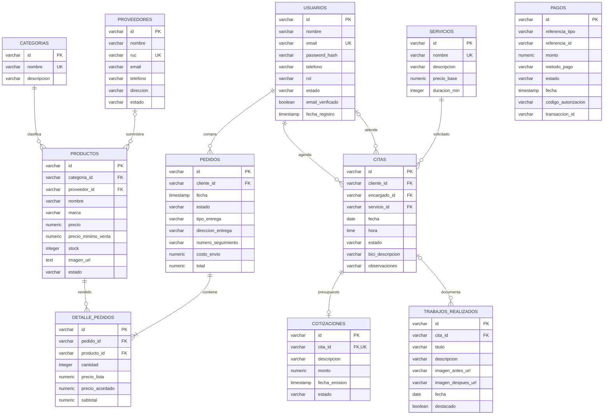

# Modelo de datos de AlphaBike

PostgreSQL organiza las tablas en cuatro esquemas. Las claves son UUID representados como VARCHAR y los importes usan NUMERIC(10,2).

| Esquema | Tablas |
|---|---|
| auth_app | usuarios |
| tienda | categorias, proveedores, productos, pedidos, detalle_pedidos |
| taller | servicios, citas, cotizaciones, trabajos_realizados |
| pagos | pagos |

`pagos.referencia_id` es una referencia polimórfica a pedido o cotización según `referencia_tipo`; no es una FK física. La existencia y propiedad se validan en PagoService. V25 aplica un índice único parcial sobre tipo e ID cuando el estado es PAGADO.

Las migraciones V1–V26 están en `backend/src/main/resources/db/migration`. La separación en esquemas se realiza en V12. No editar migraciones ya aplicadas ni usar `ddl-auto=create` en una base con datos reales. Las tablas del diagrama omiten algunos campos secundarios, como tokens temporales, para facilitar su lectura.

V26 agrega a pedidos `operacion_id` (unico y nullable) y `solicitud_hash` para ventas presenciales. El identificador permite recuperar la misma venta ante reintentos; el hash impide reutilizarlo con un contenido diferente. Los pedidos previos y los creados por checkout mantienen esos campos nulos.
