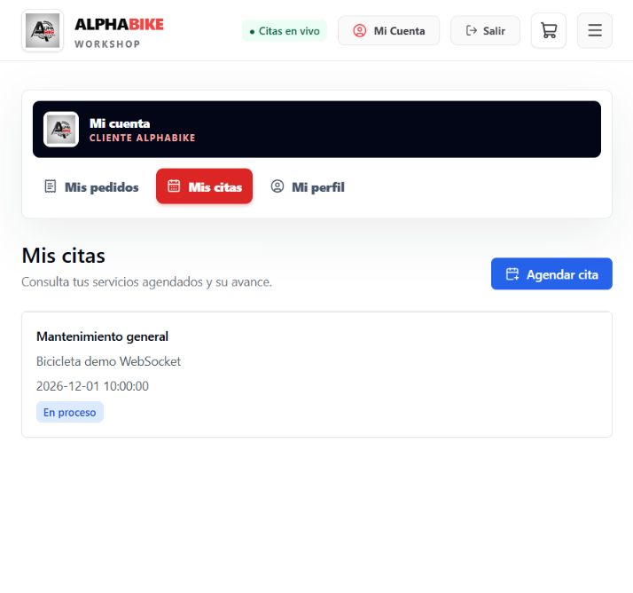

# Validación del Avance 2

Fecha de ejecución local: 9 de noviembre de 2026.

## Resultados

| Comprobación | Resultado |
|---|---|
| Suite Maven con H2 | 19 pruebas correctas, sin fallos ni errores |
| Integración HTTP y WebSocket con PostgreSQL | 5 pruebas correctas |
| Flyway sobre PostgreSQL nuevo | 25 migraciones aplicadas; Hibernate valida el esquema |
| Frontend ESLint y TypeScript | Correctos |
| Frontend Vitest | 10 pruebas correctas |
| Build de producción | Correcto |
| npm audit con umbral high | Sin alertas altas o críticas; cuatro moderadas en herramientas de desarrollo |
| npm audit --omit=dev | Sin vulnerabilidades reportadas |

Entorno local: Windows, Java 25 con objetivo de compilación Java 21, Maven 3.9.11, Node 24, Vite 8.3.7, Vitest 5.1 y PostgreSQL 18.6 en una base temporal exclusiva. El CI usa Java 21 y Node 22; el workflow del backend incluye un job de integración independiente con PostgreSQL 16 y Flyway habilitado.

## Flujos comprobados

- Crear, leer, actualizar y eliminar un servicio por HTTP con persistencia.
- Validación de entrada inválida y respuestas HTTP coherentes.
- Lectura de proveedores por ENCARGADO; rechazo del mismo acceso para CLIENTE.
- Lectura y aceptación de la cotización propia; rechazo del acceso de otro cliente.
- Cobro interno de una cotización aceptada; rechazo de pago duplicado y de modificación posterior al pago.
- Cancelación de pedido por el endpoint administrativo y por el del cliente: stock restaurado una sola vez.
- Rechazo de editar precios o cancelar directamente un pedido pagado; preparación posterior con respuesta 200.
- WebSocket real con propietario, encargado y cliente ajeno: el último no recibe datos de otra cita.
- Rechazo de JWT inválido y de un Origin no permitido; AUTH/READY, PING/PONG y SYNC/CITAS_SYNC.
- UI del cliente actualizada mediante CITA_UPDATED, sin navegación ni recarga.

## Prueba manual de navegador

Se abrió `/citas` con un usuario sintético en PostgreSQL. La interfaz mostró «Citas en vivo» y una cita pendiente. Desde otra sesión autenticada se actualizó la cita mediante la API a EN_PROCESO. La página cambió a «En proceso» y mostró la notificación sin recargar.

Después se detuvo y reinició el proceso del backend conservando la misma base PostgreSQL. El indicador cambió a reconexión y volvió a conectado; la cita conservó su estado. La reconciliación solicita de nuevo el estado persistido por REST.

## Límites

Estas comprobaciones acreditan los flujos del Avance 2, no una auditoría completa de producción. No se probaron carga masiva, despliegue multiinstancia ni proveedor bancario real. El proyecto conserva el sandbox de pagos académico. Los PR del Avance 2 están integrados. La exposición oral corresponde a las personas responsables del trabajo.

## Regresiones corregidas y verificadas — 9 de noviembre de 2026

- Las citas canceladas no admiten creación/modificación de cotizaciones ni cobros; tampoco pueden reabrirse cambiando su estado. Las citas completadas no vuelven a estados anteriores.
- El pago de una cotización publica CITA_UPDATED después de confirmar la transacción. La prueba verifica el estado persistido y que un cliente ajeno no recibe el evento.
- La API rechaza con 400 nombres de servicio mayores de 255 caracteres, precios fuera de NUMERIC(10,2) y descripciones de bicicleta vacías o fuera de 4–255 caracteres. Los textos opcionales se limitan a la longitud de sus columnas.
- Suite backend: 22 pruebas aprobadas. Integración adicional en PostgreSQL 18.6 local con Flyway y validación del esquema: 8 pruebas aprobadas. CI ejecuta la integración también con PostgreSQL 16.
- Frontend: 11 pruebas aprobadas, incluida crear/editar/eliminar servicios y volver al catálogo sin recargar; lint, typecheck y compilación aprobados.
- Menú verificado en mantenimiento con sesión administrativa a 320, 375, 768, 1024, 1280 y 1366 px, sin desbordamiento horizontal. No sustituye comprobar visualmente todas las rutas.

Para repetir las regresiones de servidor ejecutar `mvn -B test`; para PostgreSQL usar las variables TEST_DB_* documentadas en la guía. La prueba del catálogo se encuentra en `src/pages/admin/GestionServicios.test.jsx` del frontend.

## Ampliacion de correcciones del catalogo y validacion

- Categorias, productos ADMIN/ENCARGADO, stock, compras/cancelaciones y galeria invalidan el catalogo publico despues de mutaciones satisfactorias.
- Los parametros de stock ausentes, no numericos, fraccionarios, negativos o fuera de Integer responden 400 y conservan el stock anterior.
- Se ampliaron limites de textos persistidos y precision monetaria en los DTO, incluyendo categorias, productos, cotizaciones y pagos.
- Login rechaza cuentas sin verificar y no las activa automaticamente; permite el reenvio de verificacion ya disponible en la interfaz.
- Contacto prepara una consulta por WhatsApp, conserva el borrador e indica que el usuario debe enviarla desde WhatsApp.
- Resultado local: 26 pruebas backend, 10 integraciones PostgreSQL con Flyway y 16 pruebas frontend aprobadas. Lint, typecheck y compilacion frontend verificados.

La prueba de Contacto simula window.open: no envia datos ni mensajes a terceros. Las pruebas de base de datos usan exclusivamente datos sinteticos.
